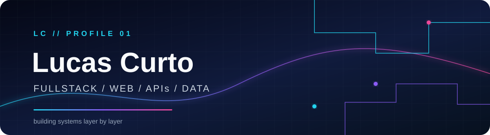

  

  <a href="https://lc-curto.github.io/Portifolio/">Portefólio</a> ·
  <a href="mailto:lucas.scurto@gmail.com">Email</a>

## FULL-STACK WEB DEVELOPER

Interfaces on the surface. APIs in the structure. Data at the base.

I build web projects across the frontend and backend, and I am developing my skills through practical work and formal training. I also run a cosmetics distribution company; that experience inspired my current project.

## CURRENT PROJECT — COSMETICS HUB

**Cosmetics Hub** is a commercial-management MVP for cosmetics businesses. Its scope includes companies, customers, catalog, inventory, orders, and receivables. The project is split into a Python/FastAPI API and a React/TypeScript web application.

- **[API](https://github.com/lc-curto/distribution-hub-api):** working foundation with a health endpoint, automated tests, and PostgreSQL configured for local development.
- **[Web app](https://github.com/lc-curto/distribution-hub-web):** initial React and TypeScript scaffold.

The [learning roadmap](https://github.com/lc-curto/distribution-hub-api/blob/main/docs/learning-roadmap.md) tracks the next development steps. Implemented features and planned work are documented separately.

## STACK

  

## ABOUT

My training covers software development, algorithms, object-oriented programming, SQL and NoSQL databases, frontend and backend development, software quality, design patterns, UML, and web and mobile projects.

## EM PORTUGUÊS

Sou o Lucas, desenvolvedor de software em formação, com foco em desenvolvimento web full-stack. Estou a aplicar o que aprendo em projetos práticos, incluindo o **Cosmetics Hub**, uma aplicação de gestão comercial inspirada na minha experiência no setor da distribuição de cosméticos. Consulte o [portefólio](https://lc-curto.github.io/Portifolio/) para ver os projetos e entrar em contacto.

## CONTACT

[Email](mailto:lucas.scurto@gmail.com) · [LinkedIn](https://www.linkedin.com/in/lucas-curto-779a692b9/) · [Portfolio](https://lc-curto.github.io/Portifolio/)
